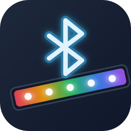

# Govee Bluetooth for Home Assistant

Local control of Govee LED strips over Bluetooth LE. No cloud, no Wi-Fi, no
Govee account. Works with any Bluetooth adapter Home Assistant can use,
including **ESPHome and Shelly Bluetooth proxies**, so the strips only need to
be in range of a proxy rather than the Home Assistant host.

Built for the **H6159**, whose Wi-Fi radio tends to drop off the network after
a day or two while its Bluetooth side keeps answering. The same wire protocol
is used by the rest of that generation of strips (see
[Supported models](#supported-models)).

## What you get

- Automatic discovery when a strip advertises near any connectable adapter or proxy.
- `light` entity with on/off, brightness, RGB colour, colour temperature
  (emulated with the RGB LEDs, the way the Govee app does it) and the
  firmware's built-in scenes as effects.
- Real state read-back, not just optimistic state: power, brightness and
  colour are polled on a configurable interval, and the keep-alive echo keeps
  the power state fresh while a connection is open.
- Connections are short-lived by default so a proxy's limited connection
  slots are shared fairly between strips, with a configurable linger so a
  burst of commands reuses one connection.
- Unknown models are asked which colour command format they speak, with a
  read-only check first and an opt-in active probe behind a consent screen.
- Diagnostics download with the last known state, Bluetooth reachability and
  the colour sub-mode from the table, the light and any override, plus the
  last connection's GATT write properties and selected write procedure.

## Requirements

- Home Assistant 2025.6 or newer.
- A **connectable** Bluetooth source. For ESPHome proxies that means
  `bluetooth_proxy: active: true` in the device config. A proxy without
  active connections can discover the strip but cannot control it.
- The strip must not be connected to the Govee app at the same time. Govee
  firmware accepts one BLE connection; close the app if commands fail.

## Installation

### HACS

1. HACS → three-dot menu → **Custom repositories**.
2. Add this repository URL with category **Integration**.
3. Install **Govee Bluetooth** and restart Home Assistant.

### Manual

Copy `custom_components/govee_bluetooth` into your `config/custom_components/`
directory and restart Home Assistant.

## Setup

Strips are discovered automatically. Once a supported strip advertises, a
notification appears under **Settings → Devices & services**. Confirm it,
give it a name, done.

To add one by hand, use **Add integration → Govee Bluetooth**. It lists every
Govee light currently visible to a connectable adapter. You can override the
model if the advertised name does not include it.

### Unknown models: finding the colour dialect

Govee reuses a few colour command formats ("sub-modes") across its range, and
the model table in this integration is built from a decompiled app and
community captures. That table can be wrong: the app lists the H6181 as
`0x02` / 0-255, but real firmware 2.03.11 speaks `0x0D` / 0-100. So for a
model that is not in the table, setup asks the light instead of guessing.

**Step 1, read-only, always runs.** After you confirm the name, Home Assistant
connects and sends the four status reads (firmware version, power, brightness,
mode). Nothing is written. If the light is showing a plain colour, the mode
reply names the sub-mode (`0x02`, `0x0D` or `0x15`), it is stored with the
firmware string, and setup finishes. If the light is running a scene, music
mode, or something unrecognised, a screen shows what was learned and offers:

- *Set the light to a plain colour in the Govee app, then retry* (safest);
- *Run the active probe* (step 2);
- *Skip* and finish with the H6159 dialect, which you can change later under
  **Configure**.

The same check also runs for **known** models on every status read. If the
light reports a colour sub-mode that disagrees with the table, the light wins,
a warning is logged, and the observed value is stored. That is what would have
caught the H6181.

**Step 2, active, opt-in only.** This writes a test colour to the light in
each candidate sub-mode (table guess first) and reads the mode back. A
sub-mode is accepted only when the reply echoes both the sub-mode byte and the
value that was sent; firmware that does not understand a frame usually ignores
it and keeps reporting the previous mode, so the sub-mode byte alone proves
nothing. For `0x02` and `0x0D` the echoed value is the test RGB. The `0x15`
reply carries no RGB, only a colour temperature, so for `0x15` the test write
is a white at 4300 K (or 6700 K if the light already reports 4300 K) and the
echo is that kelvin. The consent screen states the risk, and so does this
README:

- the light will change colour briefly;
- writes in an unsupported format have not been seen to damage either tested
  light (H6159, H6181) but cannot be guaranteed harmless;
- if the light stops responding, recovery is a power cycle of the light
  followed by a reload of the config entry.

The probe records power, brightness and mode first and restores what it can
afterwards. It never sends scene IDs, never writes brightness above 100, and
if the connection drops mid-sequence it stops, reports the partial result and
does not retry. The `0x15` kelvin echo is taken from the decompiled app's
reply parser and has not yet been confirmed on an RGBIC strip; the probe
history in the diagnostics download is how that gets confirmed.

**Every probe run is kept.** The last three runs from setup or **Configure**,
successful or not, are stored on the config entry with the raw frames they
exchanged, and appear under `probe_history` in the diagnostics download
(device page → three dots → *Download diagnostics*). The same download also
carries the last 200 frames the running integration sent and received under
`frames`. For a model that is not yet verified, that file is what to attach
to an issue; no debug logging needed.

The brightness scale is **not** probed; the only way to tell 0-255 from 0-100
is to write above 100, which the H6181 silently ignores. It is derived from
the detected sub-mode instead (`0x02` → 0-255, `0x0D`/`0x15` → 0-100) and can
be overridden under **Configure**.

### Firmware changes

The first status poll on each Bluetooth connection reads the firmware version.
A changed version updates Home Assistant's device information; the last ten
changes (time, previous and current version) are included as
`firmware_history` in diagnostics. This history lasts until the integration
reloads. Colour dialect read-back still runs on every poll and honours manual
overrides. An unanswered version query is retried on the next poll.

The Pi census also reports discovered OTA services; see
[bench firmware inspection](tools/README.md#firmware-update-capabilities).
Firmware installation and checking for available releases are not implemented.

### Options

**Configure** opens a menu: *Settings and manual overrides*, *Re-run the
read-only dialect check* and *Run the active dialect probe*. The last two are
for when a firmware update changes the dialect or you change your mind about
step 2; the active one goes through the same consent screen.

Open the integration's **Configure** dialog to tune:

| Option | Default | Notes |
| --- | --- | --- |
| Poll interval | 120 s | Each poll opens a brief connection and reads power, brightness and mode. |
| Keep connection open after a command | 8 s | Consecutive commands (e.g. dragging a slider) reuse the connection. `0` disconnects immediately. |
| Colour sub-mode override | Automatic | Automatic uses the sub-mode the light reported, else the model table. Force `0x02`, `0x0D` or `0x15` if colour commands are ignored and a probe could not settle it. An override also stops the on-read check from switching dialect, though the disagreement is still logged. |
| Brightness scale override | Automatic | Automatic derives the scale from the colour dialect (`0x02` is 0-255, confirmed on the H6159; `0x0D` and `0x15` are 0-100, confirmed on the H6181). If brightness only ever looks dim or jumps to full, force the other scale. |

## Supported models

Discovered automatically (advertised as `ihoment_`, `Govee_`, `GBK_` + `_` + model, or
`GV` + model such as `GVH6159_1A2B` and `GVH600B4F5A`):

| Model | Status |
| --- | --- |
| H6159 | Verified on hardware (firmware 1.07.02) through an ESPHome Bluetooth proxy: power, brightness, RGB, colour temperature and status read-back. |
| H6110, H6109, H614A, H614B, H614E | Same app module as the H6159 in the decompiled Govee app. Untested on hardware. |
| H6127, H6107, H6116, H6161, H6129, H6139, H6141, H6142 | Same legacy colour dialect per the decompiled app and community captures. Untested on hardware. |
| H6104, H6117, H6125, H6126, H6135, H6137, H6138, H6160, H6163, H6170, H6171, H6172, H6182, H6188, H6195 | Same legacy colour dialect per community captures. Untested on hardware. |
| H6181 | Verified on hardware (firmware 2.03.11) through an ESPHome proxy: power, brightness, RGB, colour temperature, scenes and read-back. Uses the 0x0D colour scheme and 0-100 brightness, unlike the rest of this table. |
| H6006 (RGBWW bulb) | Verified on hardware (firmware 1.00.38, hardware 1.02.01) with the Pi bench rig: power, brightness, RGB and colour temperature in the `0x0D` scheme. Brightness is 0-100 (higher bytes render dimmer); colour temperature runs 2700-6500 K and the slider is limited to that; none of the legacy scene IDs run, so no effects are offered. |
| H7020, H7021 (outdoor string lights) | Same legacy colour dialect per community captures. Untested on hardware. |
| H6143, H6144, H619A, H619B, H619C, H619E, H619Z, H61A0, H61A1, H61A2, H61E1 (RGBIC strips) | Segmented `0x15` colour dialect with a whole-strip mask, brightness 0-100, per the decompiled Govee app. Whole-strip colour and white only; no scenes yet. Untested on hardware. |
| H61B5 (RGBIC strip with covers), H61E5 (COB strip Pro, RGBIC+W) | Listed as `0x15` on the strength of their siblings (H61B2, H61E0, H61E1 in community BLE captures) and the H61E5's CSA listing as an H61E1 variant. No BLE capture of either exists yet. Untested on hardware. |
| H6199 (RGBIC TV backlight) | Same `0x15` dialect. Untested on hardware. |
| H618A (RGBIC strip), H6168 (RGBIC TV backlight) | Same `0x15` dialect, placed by family. Hardware on hand; verification pending. |
| H617A (RGBIC strip) | `0x15` dialect on pact 10/1 per three independent community captures (GENZERO fw 3.02.24, rnodern, ha-govee-led-ble). Untested here. |
| H6052, H6056, H6059, H6061, H6062, H6065, H6072, H6076 (RGBIC light bars, lamps and panels) | Same `0x15` dialect. Untested on hardware. |

Some H616x and H618x firmware takes brightness as 0-100 rather than 0-255. If
a strip from that range jumps to full brightness at low slider values, switch the
**Brightness scale** option to 0-100.

RGBIC models drive every segment the same colour. Per-segment colour, music
mode and the RGBIC scene tables are not implemented yet.

Any other Govee light can be added manually. Setup then runs the dialect probe
described under [Setup](#unknown-models-finding-the-colour-dialect); if that
cannot settle it, the light is driven with the H6159 dialect and the sub-mode
can be forced under **Configure**. Open an issue with the model and the
detected sub-mode and it can be added to the table.

## Finding out what a light speaks

`tools/govee_rig.py census` on a Raspberry Pi, or the Census mode of the
[Govee Dance Party](https://github.com/Mezzle/govee-dance-party) Flipper
app and ESP32 image, record what a light answers and optionally which
colour dialect it echoes, as `govee-evidence/1` records. `tools/govee_report.py`
turns those logs into a compatibility report with a verdict, a confidence
and the sources behind each claim. See `tools/README.md`,
`docs/evidence-schema.md`, `docs/census-gap-analysis.md` and, for the
encrypted and secret-locked families, `docs/encrypted-protocol-matrix.md`.
The supporting security research is collected in
`docs/bluetooth-encryption-research.md`,
`docs/pairing-secret-research-sources.md`, and
`docs/cheap-pairing-secret-test-hardware.md`.

## How it talks to the strip

All frames are 20 bytes: type, command, payload, zero padding, XOR checksum.
Writes go to characteristic `…2b11`, replies arrive as notifications on `…2b10`.
The client uses writes with response when supported, otherwise writes without
response, for commands, queries and keep-alives alike.

| Action | Frame |
| --- | --- |
| Power on / off | `33 01 01` / `33 01 00` |
| Brightness | `33 04 <level>` |
| Colour | `33 05 02 R G B 00` |
| White (colour temperature) | `33 05 02 FF FF FF 01 R G B` with a kelvin-derived tint |
| Colour (RGBIC) | `33 05 15 01 R G B 00 00 00 00 00 FF 7F`, the trailing bytes being a whole-strip segment mask |
| White (RGBIC) | `33 05 15 01 FF FF FF <kelvin hi> <kelvin lo> R G B FF 7F` with a kelvin-derived tint |
| Scene | `33 05 04 <id lo> <id hi>` |
| Keep-alive / power query | `AA 01 00`, answered with `AA 01 <0|1>` |
| Brightness query | `AA 04 00` |
| Mode query | `AA 05 01`; an RGBIC reply is `AA 05 15 01 <kelvin hi> <kelvin lo>`, kelvin 0 carrying no confirmed white temperature |

The integration sends a keep-alive every two seconds while a connection is
open. This is a client policy; the sources do not establish a universal
firmware idle timeout. The reply doubles as a power-state update, which is how a
change made with the physical remote shows up in Home Assistant between polls.

Sources: the H6127 and H6159 reverse-engineering repositories by
BeauJBurroughs and jurassic-marc, the H617A work by rnodern, and the
decompiled-app protocol reference in Brady-Woods/govee-ble-local.

## Troubleshooting

- **"not visible to any connectable Bluetooth adapter or proxy"**: nothing
  that can make connections currently sees the strip. Check the proxy has
  `active: true`, or move it closer. The diagnostics download includes Home
  Assistant's own reachability explanation.
- **Commands time out while the Govee app is open**: close the app. The strip
  only accepts one connection.
- **Brightness looks wrong**: force the brightness scale under Configure.
- **Colour is ignored on a model not in the table**: run the read-only check
  from Configure with the light showing a plain colour, or the active probe.
- **Light unresponsive after the active probe**: power-cycle it, then reload
  the config entry.
- **Reporting an unverified model**: download the diagnostics from the device
  page and attach the file. It holds the model, firmware, dialect in use, the
  last 200 frames and every recent probe run with its frames.
- **Enable debug logging** to see every frame as it happens:

  ```yaml
  logger:
    logs:
      custom_components.govee_bluetooth: debug
  ```

## Development

```bash
python -m venv .venv && .venv/bin/pip install -r requirements_test.txt
constraints="$(.venv/bin/python -c 'import homeassistant, pathlib; print(pathlib.Path(homeassistant.__file__).parent / "package_constraints.txt")')"
.venv/bin/pip install -c "$constraints" -r requirements_test_bluetooth.txt
.venv/bin/pytest
.venv/bin/ruff check .
```

The protocol layer (`protocol.py`) has no Home Assistant dependency and its
tests pin every frame to published captures. The entity and config flow tests
run against Home Assistant's real Bluetooth manager with a fake H6159 that
answers status queries the way real firmware does.

### Bench test rig

Research on additional state readback, IC/topology diagnostics and app-independent
BLE control is collected in
[BLE readback and control research](docs/ble-readback-and-control-research-2026-10-24.md).
It distinguishes existing support, source-derived possibilities and work requiring
later hardware qualification.

`tools/govee_rig.py` drives a light from any Linux machine with BlueZ (a
Raspberry Pi next to the strip, for instance) using the same `protocol.py`,
`models.py` and `probe.py` as the integration, with no Home Assistant
installed. It scans, runs the status reads and the active probe, sends named
or raw frames, and reports whether the light echoes each write. See
[tools/README.md](tools/README.md).
